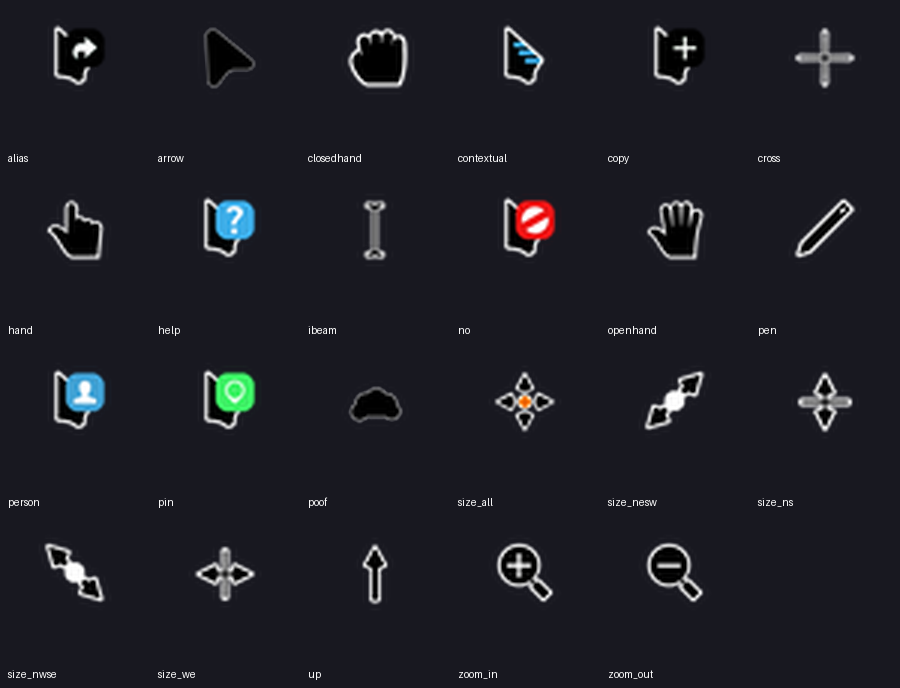

# BlackMac Cursors

Black macOS-style cursors for Windows 10/11 — black fill, super-thin white outline, and the spinning beach ball for busy.

## Install

1. Extract the ZIP.
2. Double-click `BlackMac-Cursors/Install.bat` (it will ask for admin permission). It copies the files, registers the scheme and applies it right away.
   - Or right-click `BlackMac-Cursors/Install.inf` → Install, then pick the **Black Mac** scheme in Settings → Bluetooth & devices → Mouse → Additional mouse settings → Pointers → Apply.
3. To test them, open `BlackMac-Cursor-Test.html` (single file, just double-click it) and hover the boxes.

## What's inside

- 23 static cursors (`.cur`) + 2 animated (`.ani`)
- Every `.cur` has 32 / 48 / 64 / 256 px inside, with the click point set correctly
- Busy is the macOS beach ball; Working In Background is the arrow + beach ball

| Role | File |
| --- | --- |
| Normal Select | arrow.cur |
| Help Select | help.cur |
| Working In Background | appstarting.ani |
| Busy | wait.ani |
| Precision Select | cross.cur |
| Text Select | ibeam.cur |
| Handwriting | pen.cur |
| Unavailable | no.cur |
| Vertical Resize | size_ns.cur |
| Horizontal Resize | size_we.cur |
| Diagonal Resize 1 | size_nwse.cur |
| Diagonal Resize 2 | size_nesw.cur |
| Move | size_all.cur |
| Alternate Select | up.cur |
| Link Select | hand.cur |
| Open Hand / Closed Hand | openhand.cur / closedhand.cur |
| Copy / Alias / Context Menu | copy.cur / alias.cur / contextual.cur |
| Zoom In / Zoom Out | zoom_in.cur / zoom_out.cur |
| Person / Pin / Poof | person.cur / pin.cur / poof.cur |

## Credits

- Cursor shapes adapted from [BreezeX](https://github.com/ful1e5/BreezeX_Cursor) by ful1e5 (GPL-3.0)
- Arrow artwork: MeowSamOP DZN (original)
- Beach ball and poof cloud drawn for this pack

## License

See `LICENSE.txt` — it splits the pack in two:
- **Original files** (arrow.cur, wait.ani, appstarting.ani, poof.cur, installer, test page, docs): do not give away, re-upload, sell, or share without permission from MeowSamOP DZN.
- **BreezeX-derived files** (the other 20 `.cur` files): GPL-3.0 — free to share and resell under the GPL terms, see `LICENSE`.
